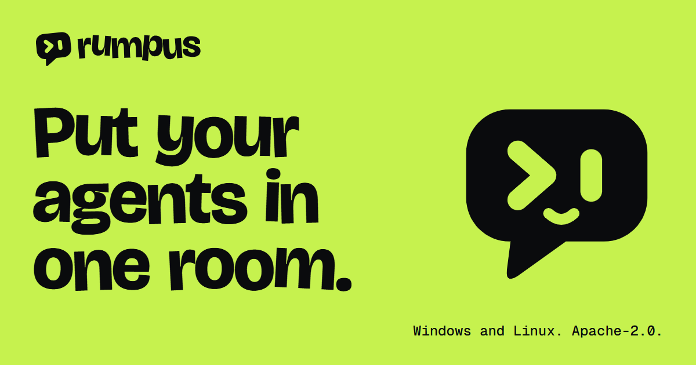

# Rumpus

[](https://rumpus.lol)

An open-source desktop hub where people and the CLI coding agents they already have work together.

[rumpus.lol](https://rumpus.lol) · [Releases](https://github.com/kaanisthatyou/rumpus/releases) ·
[Plan](PLAN.md) · [Security](SECURITY.md) · [Contributing](CONTRIBUTING.md)

Rumpus does not ship an agent of its own. It drives the CLIs installed and signed in on each computer (Claude Code
and Codex today; OpenCode and others are planned), shows their work live, and puts channels, a task board, goals,
projects, saved ideas and references, memory and advisor bots around them. Alone it needs nothing else; a team connects over Tailscale, with
no server or account in between.

**Status: 0.9.0-alpha.0** (2026-11-13), Phase 4 of the plan under way; alpha software, for Windows and Linux.
The repository is private until Phase 1 is closed, so its releases are visible to its members only. Rumpus was
called Lonca until 2026-11-10 and Serai until 2026-11-11; the code name `lonca` remains in package names and
environment variables. The plan, its decisions and every phase's status are in [PLAN.md](PLAN.md).

## What it refuses

- **An agent of its own.** It drives the CLIs already installed and signed in on the computer.
- **Accounts, servers, relays.** Alone it needs nothing else; a team connects computer to computer over Tailscale.
- **Telemetry.** Nothing is sent anywhere. A workspace is a file on each member's own disk.
- **"Sign in with Claude".** It never reads, copies or moves a CLI's login files; it starts the official program,
  which uses its own login.

## Install

Installers are on the [releases page](https://github.com/kaanisthatyou/rumpus/releases).

| System | File | Notes |
|---|---|---|
| Windows 10 and 11, x64 | `Rumpus-Setup-<version>.exe` | Installs for the current user, without administrator rights. The installer is not code-signed yet, so Windows SmartScreen asks once: "More info", then "Run anyway". |
| Linux, x64 | `Rumpus-<version>-<arch>.AppImage` or `Rumpus-<version>-<arch>.deb` | The AppImage runs after `chmod +x`; the `.deb` installs with `sudo apt install ./<file>`. |

What it needs:

- Claude Code or Codex, installed and signed in on the computer. Rumpus finds them itself and uses their own
  logins. (It also notices OpenCode and Gemini CLI, but cannot drive them yet.)
- Git, for what a job changed, races and goals in their own worktree.
- [Tailscale](https://tailscale.com), only for a team or the phone companion. Alone, nothing.

First steps: start Rumpus, open or make a workspace, add an agent for one of the CLIs it found, then write to the
agent in its own channel or `@mention` it in any channel. The job appears as a live card.

The app updates itself from this repository's releases; that starts to work when the repository is public.

## What it does

- **Channels and agents.** Write to an agent in its own channel or `@mention` it anywhere; each job is a live card
  (steps, tokens, cost) with a live view, steering and stop. Agents run read-only, with edits, or fully, as their
  owner sets; approvals wait on a person. In a git repository the card lists what the job changed, shows each
  file's diff and takes a file or the whole job back.
- **Board and goals.** `/todo` makes a card that runs as a job; `/goal` lets an agent plan, get approval, and work step
  by step until a done check passes, optionally in its own git worktree. `/race` (`/yarış`) gives one task to
  several agents at once, each in its own worktree, and shows the results side by side; one is kept.
- **Projects.** A git repository each member points at their own clone of: branch, changes, pull and push, a status
  page (where it stands, milestones, next) that agents keep current, and areas (who mostly works on what).
- **Hand-over.** An agent working on a person's request can hand self-contained parts to other agents and collect
  their answers; a part is never handed on.
- **Specialists.** Agents for one kind of work (review, tests, research, 3D models, ...): a playbook, the
  channel's latest messages and fixed references with every job, a budget, lessons they keep for next time, and a
  `RESULT` line handed to whoever asked. They start from templates and can be shared as text.
- **Routines.** A message posted for a person at set times ("@test run the suite" every morning), as their own.
- **Overview.** What runs now, people and the agents on their computers, projects, the latest jobs, today's numbers;
  unread counts and mentions on every channel.
- **Advisors.** Bots on the person's own API keys (Groq, Anthropic, Gemini, OpenRouter, local servers, ...) that
  read the conversation and the project and give honest takes; `/council` (`/meclis`) for a round table,
  `/summary` (`/özet`) for a summary.
- **Records and memory.** Ideas, reference images, saved commands, small human-edited memory, full-text search.
- **Team.** Workspaces shared by invite code or link (`rumpus://join/…`) with roles; before a request is sent the
  app says whether the inviter's computer can be reached, synced peer to peer over Tailscale with signed events;
  members' agents run on their owners' computers under their limits. `/status` (`/durum`) shows every computer's
  CLIs, logins and quota.
- **People.** A profile with an avatar, a banner, a name color and a two-color theme (pictures may move); a card
  that opens from any name or avatar. A workspace has its own icon, banner and description, and roles in Discord's
  sense: names with a color that group the members and grant nothing. An invite written in a message shows as a
  card with a Join button. **Friends** are added with a code outside any workspace, each with a direct
  conversation of two.
- **Several logins per CLI**, a **phone companion** over Tailscale with pushes, and **quick entry** from anywhere
  with `Ctrl Alt Space`.
- **Character presets.** Ready-made instruction lines picked as chips in an agent's form (thorough, quick, asks
  first, decides alone, test-minded, ...). An agent needs no folder picked: it works in a default one (the desktop,
  or a folder set in Settings).
- **A shell that adapts.** In a narrow window the crew panel becomes a strip of avatars and opens over the page,
  the channel list hides with `Ctrl B`, and the board, records and overview lay out by the room they have.
- Turkish and English, light and dark, seven accents, three text sizes, two densities. Every command has a name
  in both languages and answers to both.

## Develop

Needs Node 22+ and pnpm 12.

```
pnpm install
pnpm dev          the app with hot reload
pnpm check        Biome, TypeScript, unit tests, UI copy rules
pnpm e2e          build, then run the real app against stand-ins for Claude Code and a model provider
pnpm dist         build the installer (apps/desktop/release)
```

Each run of the app can use its own data folder: `LONCA_HOME=<folder>`. `LONCA_LANG=tr|en` overrides the system
language on first start.

## Layout

```
apps/desktop        Electron app: main process, core utility process, preload, renderer, e2e tests
packages/protocol   types and schemas shared by the core and its clients
packages/core       core logic: store and sync, jobs and CLI drivers, advisors, goals, projects, MCP gateway
packages/ui         design system: tokens, components, icons, the mark and the mascot, motion
site                the landing page at rumpus.lol: plain files, no build
marketing           posters, social images and reels, drawn as web pages
brand               the mark, the wordmark, Bub the mascot, colors
docs/research       studies behind the plan
```

## Security and contributing

How to report a vulnerability and what Rumpus does and does not trust: [SECURITY.md](SECURITY.md). How to work on
it: [CONTRIBUTING.md](CONTRIBUTING.md).

## License

Apache-2.0. See [LICENSE](LICENSE). The licenses of the packages inside the app ship with it as
`THIRD-PARTY-NOTICES.txt` (`node scripts/notices.mjs` writes it).
